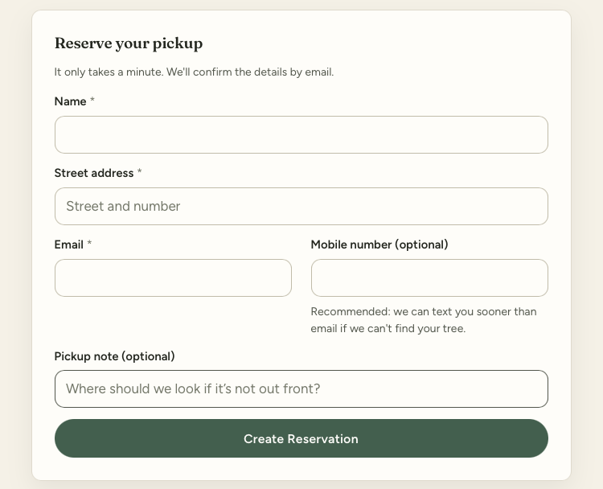
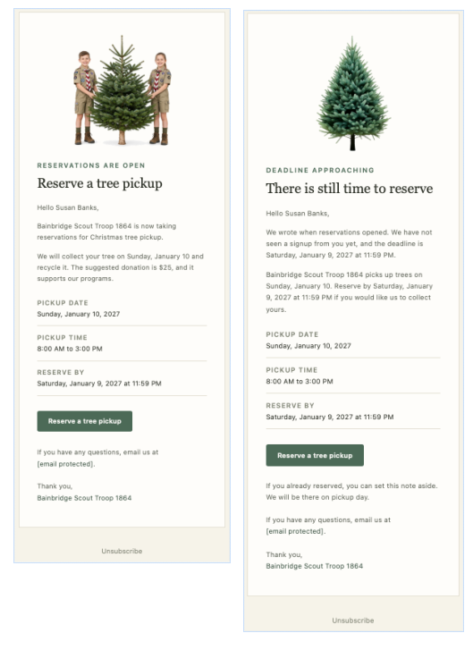

# Scout Tree Recycle

Tree Recycle is a Rails application for running a Christmas tree recycling fundraiser. Families reserve a pickup and can donate. Organizers manage reservations, routes, drivers, and messages in an admin site. Drivers use a separate pickups portal.

Written by [Carson Cole](https://github.com/carsoncole), a former Scoutmaster of Troop 1564 on Bainbridge Island, WA.

## Screenshots

Families reserve a pickup on a short form. They enter a name, address, and email, and can add a mobile number and a note about where to find the tree.



The two built-in marketing emails. The first says reservations are open. The second reminds people who have not signed up that the deadline is near. Organizers edit both under **Admin → Marketing**.



## Features

**Public site.** Families reserve a tree pickup and can update or cancel it. They can donate by card, cash, or check, skip the donation, or donate without a reservation. The site also has About and privacy pages, a thank-you gallery, a maintenance page, and a pickup-day notice that can replace the signup form.

**Admin.** Organizers work from one back office:

- Reservations, with address verification review, lookup, and assignment onto routes. Routes can also be assigned by hand.
- Zones, routes, and drivers.
- A pickup overview and a printable PDF of pickups still waiting.
- Donation records and charts of reservations and donations.
- Text-message conversations and an email inbox, including replies.
- Two marketing campaigns, plus editable reservation emails for confirmation, cancellation, and a missing tree.
- Settings for the event dates, the organization, the public pages, email, texts, donations, and routing.
- Admin accounts, error logs, zip backups and restores for reservations, contacts, and settings, and a close-event step that keeps contacts for the next year.
- A view of background jobs, such as mail, texts, and geocoding.

**Driver pickups.** Drivers open a separate site with a shared key. They see routes on a map, update a stop as picked up or missing, mark favorite routes, and print pickup lists.

## What you need

On your computer:

- macOS, Ubuntu, or Windows with [Ubuntu on WSL](https://guides.rubyonrails.org/install_ruby_on_rails.html#install-ruby-on-windows)
- Git
- Ruby 4.0.10 and Rails 8.1.4.1
- PostgreSQL 14 or newer, running on your computer

To publish the site, also have:

- A Linux server you can log into as root over SSH. A small virtual server is enough.
- A domain name with an A record pointing at that server
- [Docker](https://docs.docker.com/get-docker/) running on your computer
- A [Docker Hub](https://hub.docker.com) account and an access token
- A hosted PostgreSQL database that accepts connections from the server

## 1. Get the code

```sh
git clone https://github.com/carsoncole/scout-tree-recycle.git
cd scout-tree-recycle
```

## 2. Install Ruby and Rails

This app uses Ruby 4.0.10, the version in `.ruby-version`. Chruby works great for handling Ruby versions on Mac. [Rails install guide](https://guides.rubyonrails.org/install_ruby_on_rails.html).

When both are installed, run a check on your console:

`ruby --version` prints `ruby 4.0.10`. `rails --version` prints `Rails 8.1.4.1`.

## 3. Install PostgreSQL

The app stores its data in PostgreSQL. Install it and leave it running before the next step, so the database library can compile.

### macOS

```sh
brew install postgresql@17
brew services start postgresql@17
echo 'export PATH="$(brew --prefix postgresql@17)/bin:$PATH"' >> ~/.zshrc
source ~/.zshrc
```

### Ubuntu

```sh
sudo apt install postgresql postgresql-contrib libpq-dev
sudo service postgresql start
sudo -u postgres createuser -s $USER
```

The last command lets your user create the development databases.

On Windows, use Ubuntu on WSL and follow the Ubuntu steps above.

## 4. Configure the database

Install the libraries the app uses:

```sh
bundle install
```

Open `config/database.yml`.

The `development` and `test` sections are for your computer. They use PostgreSQL on `localhost` and these database names:

- `scout_tree_recycle_development`
- `scout_tree_recycle_test`

Add a `username` and `password` there if your local server asks for them.

The public site uses the `production` section. Its database name is `scout_tree_recycle_production`, under `production` → `primary` → `database`. Change that name if yours is different. Leave `idle_timeout: 60` so unused connections close.

Create that empty database and allow the server to connect. The host, username, and password are not in this file. Rails credentials supply them, under the key `database`.

Rails stores secrets in `config/credentials.yml.enc`. The key that opens it is `config/master.key`. Git ignores the key. Keep a copy somewhere safe. Deploy sends it to the server.

A fresh clone has no key. Create a new secrets file. On Ubuntu, install nano first with `sudo apt install nano` if that command is missing.

```sh
rm config/credentials.yml.enc
EDITOR="nano" bin/rails credentials:edit
```

If someone already gave you `config/master.key`, put that file in `config/` and skip the `rm` line. Run the `credentials:edit` command on its own.

In nano, add the database host, username, and password, then press Ctrl+O, Enter, and Ctrl+X:

```yaml
database:
  host: your-host
  username: your-username
  password: your-database-password
```

## 5. Start the app on your computer

```sh
bin/setup --skip-server
bin/rails db:seed
bin/dev
```

`db:prepare` inside setup creates the local databases. `db:seed` loads the built-in email templates. The site is at [http://localhost:3000](http://localhost:3000).

On the first visit, the app opens the initial setup page at [http://localhost:3000/admin/settings/new](http://localhost:3000/admin/settings/new). Only the admin email, password, and password confirmation are required. Sign in later at [http://localhost:3000/admin](http://localhost:3000/admin).

Stop the server with Ctrl+C. Start it again with `bin/dev`.

For a local demo, load example zones, routes, drivers, and reservations for Bainbridge Island, Washington. It can be loaded by the UI, or in terminal:

```sh
bin/rails sample_data:load
```

## 6. Deploy with Kamal

[Kamal](https://kamal-deploy.org) packs the app into a Docker image and runs it on your server. The first command installs Docker there. Later commands publish updates.

Edit `config/deploy.yml`:

| Setting | Set it to |
| --- | --- |
| `image` | Your image name, such as `yourname/scout-tree-recycle` |
| `servers` → `web` | The server's IP address |
| `registry` → `username` | Your Docker Hub username |
| `proxy` → `host` | Ip address or domain, ex: `treerecycle.example.org` |

`proxy.ssl: true` requests a free HTTPS certificate. Point the domain at the server first, and leave ports 80 and 443 open. When the domain uses Cloudflare, set SSL/TLS encryption mode to **Full**.

Create the secrets file Kamal reads. Git ignores it.

```sh
cp .kamal/secrets.sample .kamal/secrets
```

Open `.kamal/secrets`. Replace `$KAMAL_REGISTRY_PASSWORD` with your Docker Hub access token, or export that variable in the shell before you deploy. Leave the `RAILS_MASTER_KEY` line as it is. It reads `config/master.key`.

From the project folder:

```sh
bin/kamal setup
```

When that finishes, open `https://your-domain` and complete the first-run form. Then load the email templates on the server:

```sh
bin/kamal app exec --reuse "bin/rails db:seed"
```

Publish later changes with:

```sh
bin/kamal deploy
```

Save `config/database.yml` and the credentials file before you deploy. Both are built into the image. Deploy again after any later change to either file.

Follow the running app with:

```sh
bin/kamal logs
bin/kamal console
```

Deploys keep the server disk that holds background jobs and live admin updates. Replacing the server drops jobs that had not finished. Reservations and the rest of the data stay in PostgreSQL.

## Email

Outgoing mail uses any SMTP server. The settings are saved under **Admin → Settings → Email** and used on the next message.

Replies in **Admin → Mail**, together with outgoing mail, require [Resend](https://resend.com). Any other service, including Gmail, can send marketing messages, confirmations, and the other outgoing mail. Read and answer those messages in that service. They do not appear in the admin inbox.

### Send with any SMTP service

1. Turn on **Enable Email**.
2. Set **From Address** to the address recipients should see, such as `Anytown Tree Recycle <trees@example.org>`.
3. Enter the SMTP server:
   - **SMTP Address** and **Port**
   - **Username** and **Password**
   - **Authentication**: Plain, Login, or CRAM-MD5
   - **Encryption**: STARTTLS on port 587 is the usual choice. TLS encrypts the connection from the start, often on port 465. None sends without encryption.

   Gmail uses `smtp.gmail.com`, port **587**, encryption **STARTTLS**, and authentication **Plain** or **Login**. The username is the full Gmail address. The password is a Google app password.
4. Set **Site URL** to the public `https://` address of the site. Links in emails use it. That field is on the first-run form and under **Settings → Site Details**.
5. Click **Save Email Settings**, then **Send Test Email**.

A test message, admin error notices, mail composed in **Admin → Mail**, and a cancellation notice can go out once **From Address**, **SMTP Address**, and **Port** are filled in. Confirmation, missing-tree, and marketing messages also need **Enable Email** turned on. New admin users receive error notices. Each person turns that off with **Email me error logs** on **Logs** or on their profile.

`bin/rails db:seed` loads the built-in reservation and marketing templates. Edit them under **Admin → Marketing**.

### Resend

[Resend](https://resend.com) delivers replies into **Admin → Mail**. Use it when you want that inbox as well as outgoing mail.

For SMTP, the host is `smtp.resend.com`, the username is `resend`, and the password is the API key alone. Use port **587** with encryption **STARTTLS**, or port **465** with **TLS**. Some servers block outbound ports 25, 465, and 587. Resend also accepts port **2465** with **TLS**, or port **2587** with **STARTTLS**.

Replies are a separate webhook. In the Resend dashboard, add a webhook for the `email.received` event only, posted to:

```text
https://your-domain/rails/action_mailbox/resend/inbound_emails
```

Enter the API key and webhook signing secret under **Admin → Settings → Email** in the **Inbound Email - Resend** section. They are stored in the application database.

The API key is how the app downloads the full message after Resend calls the webhook. It is separate from the SMTP password. To try inbound mail on your computer, expose the app through a tunnel and add that host to `config.hosts` in `config/environments/development.rb`.

## Optional services

Turn each one on under **Admin → Settings**. With a service off, that feature stays hidden, or an admin does the work by hand. Cash, check, and "no donation" are available with card payments left off.

| Service | Used for | Setup |
| --- | --- | --- |
| [Twilio](https://www.twilio.com) | Text messages | Settings → SMS. Set the number's incoming webhook to `https://your-domain/api/v1/sms/reply`. |
| [Stripe](https://stripe.com) | Card donations | Settings → Donations. Add a webhook at `https://your-domain/api/v1/stripe-webhook` for `checkout.session.completed`, `charge.refunded`, `charge.updated`, and `payment_intent` events. |
| [Amazon Location Service](https://aws.amazon.com/location/) | Address suggestions, verification, lookup, and automatic routes | Settings → Location Services. Places v2 is the default. Add an API key restricted to `geo-places:Geocode` and `geo-places:Autocomplete` for its default provider. The legacy Places v1 access key and place index are still available for existing installs, but new features use Places v2. |

Places v2 calls `Geocode` with `IntendedUse=Storage` because the app keeps the returned coordinates on reservations. When automatic routing and Places v2 are enabled, the street field offers `Autocomplete` suggestions and a submitted address is verified against the configured pickup city, state, and country. In-area matches store coordinates; misses continue to the donation step and are left for manual routing. The typeahead only changes the street field and never changes the configured city, state, or country. New installs default to Places v2; an existing install without a Places v2 API key stays on the legacy provider until an admin adds one.

## Tests

```sh
bin/rails test
bin/rails test:system
```

## License

MIT. See [LICENSE](LICENSE).
