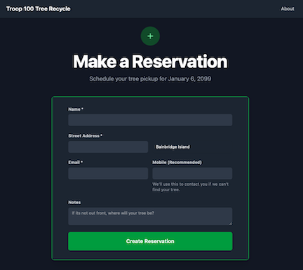
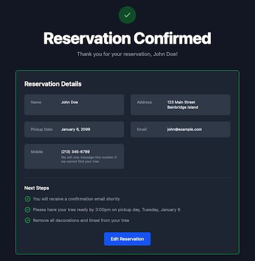

:construction: Still being updated





# Tree Recycle

Tree Recycle is a comprehensive web application that supports the running of a Christmas tree recycling fundraiser. Streamlining the tree pickup reservation and donation process and the logistics of tree pickup across a broad area.

## Features

- **Reservation Management**
  - Public website for tree pickup reservations
  - Address verification and geocoding
  - Automatic or manual routing system
  - Status tracking (pending, picked up, missing, cancelled)

- **Routing System**
  - Automatic routing with geocoding
  - Manual routing option
  - Route assignment to drivers
  - Zone-based organization

- **Donation Processing**
  - Online donation acceptance
  - Stripe integration
  - Receipt generation
  - Donation tracking

- **Communication**
  - Email notifications for:
    - Reservation confirmations
    - Pickup reminders
    - Missing tree alerts
    - Donation receipts
  - SMS notifications for missing trees
  - Marketing emails to previous customers

- **Admin Features**
  - Dashboard for reservation management
  - Route assignment interface
  - Settings configuration
  - Marketing campaign management
  - User management

- **Tree Pickups Site for Drivers**
  - Dedicated site for drivers at "/pickups"
  - PDF pickup lists (backup in case online connectivity is down)
  - Map showing pickup locations and status
  - Drivers can update status of pickups and register missing trees

## Getting started

1. Install Ruby and PostgreSQL on your local computer.

2. Install Rails:

```ruby
$ gem install rails
```

3. Clone the repo:

```ruby
$ git clone https://github.com/carsoncole/tree_recycle.gt
$ cd tree_recycle
```

4. Install gems:

```ruby
$ bundle install
```

5. Migrate the database:

```ruby
$ rails db:migrate
```

6. Start the web server:

```ruby
$ bin/dev
```

7. Go to ```http://localhost:3000``` and you should see the main reservation page.

8. Create an admin user:

```ruby
$ rails console
> User.create(email: "test@example.com", password: "password", role: "admin")
```

9. Go to ```localhost:3000/admin``` to access the admin site.


## Deployment

The application can be deployed with Kamal (https://kamal-deploy.org) to any cloud-based or local server as long as SSH root access is available.

### Prerequisites

- Docker Compose (installed locally)
- Docker account
- A host for the application with SSH root access enabled

### Steps

1. Configure ```config/deploy.yml```.
2. Congifigure your DNS settings for your domain with an 'A' record that points to the IP address of your host.
2. Launch your host. This can be any dedicated server, or even your local machine. It must have SSH root access enabled.
3. Create and configure ```.kamal/secrets```. You can use the sample file ```.kamal/secrets.sample```. Replace ```$KAMAL_REGISTRY_PASSWORD``` with your Docker access key. 
4. With your configuration complete, you need to commit your code, which is what will be used in the Docker image creation.
```ruby
$ git add .
$ git commit -a -m 'some message'
```
4. Deploy:

```ruby
$ kamal setup
$ kamal deploy
```

## Configure secrets

Use encrypted credentials to store application secrets. Remove the existing secrets:

    $ rm config/credentials.yml.enc
    $ EDITOR=vim rails credentials:edit

Copy the sample ```credentials.ymp.enc.sample```. 


## Optional Integrations Installation

Integrations provide additional features for Tree Recycle, including emails, automatic routing, SMS messaging, and donations.


### Email

With emailing configured, Tree Recycle will send automated emails confirming tree reservations, cancellations, and donation receipts. Two funnel-type marketing emails are also available to market to people who have made tree pickup reservations in the past.


Settings for GMAIL:
- address:              smtp.gmail.com
- port:                 587
- user_name:            username
- password:             password
- authentication:       plain
- enable_starttls_auto: true

Use encrypted credentials to store the settings. The follow should be your ```development.rb``` and ```production.rb``` environment files.

``` ruby
config.action_mailer.smtp_settings = {
  :address              => Rails.application.credentials.mailer.development.address,
  :port                 => Rails.application.credentials.mailer.development.port,
  :user_name            => Rails.application.credentials.mailer.development.user_name,
  :password             => Rails.application.credentials.mailer.development.password,
  :authentication       => plain,
  :enable_starttls_auto => true
}
```
> :warning: **Important GMAIL Note** Gmail is free, but there are limitations. If you are on a free account, the daily sending limit is ~500 emails. If you do hit a limit, they will temporarily shut your account. For the marketing emails, you can control the batch size of emails in Settings and it is recommended that you keep it low (<50) and send multiple times. Sending a massive block of emails may not only shut your account, but it also could get your emails flagged as SPAM, by receiving email servers. Caution is advised.

### Routing

Routing requries a mapping service to provide geocoding and geo-fencing for the assignment of pickups to routes.


For the Amazon Locations Service, you'll need an AWS account. Create a Place Index and give it a name, ie. 'tree_recycle', with the data provider 'Esri' with a single use.  You'll then need API credentials which you can obtain in your main profile under 'Security Credentials'.

Your API credentials should then be configured in your credentials file `config/credentials.yml.enc`.

```ruby
lookups:
  amazon_location_service:
    access_key_id: SOMEKEY
    secret_access_key: aSecretAccessKey
```

Update the geocoder config file with the mapping service in ``` config/intializers/geocoder.rb```.  When you create a Place Index, note the AWS region it was created in and update it accordingly in this config file.

```ruby
Geocoder.configure(
  # Geocoding options
  timeout: 10,                 # geocoding service timeout (secs)
  # lookup: :nominatim,         # name of geocoding service (symbol)
  lookup: :amazon_location_service,
  amazon_location_service: {
    index_name: 'tree_recycle',
    api_key: {
      access_key_id: Rails.application.credentials.lookups.amazon_location_service.access_key_id,
      secret_access_key: Rails.application.credentials.lookups.amazon_location_service.secret_access_key
    }
  }

Aws.config.update({region: 'us-west-2'})
```

For an address to be routed, it is first geocoded. By default, geocoding occurs on schedule set in ```recurring.yml```. Only one attempt is made to automatically geocode an address, however any address changes will retrigger another geocoding attempt. You can disable geocoding entirely in Settings for a specific reservation. 

There is a job ```GeocodeReservationsJob`` that runs on a schedule set in ```recurring.yml``.


### SMS Messaging

[Twilio.com](https://twilio.com) is used for SMS:

1. For reservations with a mobile number, if it is flagged ```Missing```, then a Missing Tree SMS will be sent. It will inform the recipient to put out their tree and to respond to the SMS by saying their tree has been put out. Once the response is received, the reservation's status can be updated to ```Pending Pickup```.
2. General SMS enquiries can be received by the application and they can be replied to.

> :warning: Getting SMS service from Twilio takes time to set up as they will do a background check on the organization, to fight against spam messaging.

Add the following details from your Twilio account into the encrypted credentials file:

```ruby
$ EDITOR=vim rails credentials:edit
```
```ruby
twilio:
  production:
    number: TWILLIO_NUMBER
    account_sid: ACCOUNT_SID
    auth_token: AUTH_TOKEN
```

In Twilio, you need to create a ```Messaging Service```, which defines the purpose behind what you plan on messaging. The use case should be "Notify my users".

In Twilio, in the section ```Develop```, ```Phone Numbers```, ```Active Numbers```, select your number and update the ```Messaging Configuration```:

```
Configure with: Webhook
A message comes in: Webhook
URL: https://YOUR_SITE_URL/sms/reply
HTTP: HTTP POST
```

### Donations

[Stripe](https://stripe.com) is used for taking donations.

#### Configuration

1. Open a Stripe account. You will need organization details, such as tax id etc.
2. Configure your default donation amount. Go to ```Product catalog > Create product > Add price```

3. Configure your Strip donation page to include your organization information, default donation amount etc. You can also select what donation methods you would like to accept.
    - Configure payment methods in ```Settings > Payments > Payment methods```
    - Configure the payment domain (what URL you will be collecting payments) in ```Settings > Payments > Payment Method Domains```

4. Obtain your keys in ```Developers > API Keys```. You will need the ```Publishable key``` and ```Secret key```.


5. Add the Stripe keys to the encrypted creditials file `config/credentials.yml.enc`:

```ruby
EDITOR=vim rails credentials:edit
```

```
stripe:
  development:
    publishable_key: PUBLISHABLE_KEY
    secret_key: SECRET_KEY
  production:
    publishable_key: PRODUCTION_KEY
    secret_key: SECRET_KEY
```

6. Configure Stripe webhook. In Stripe, ```Developers > Webhooks > Webhook endpoints > Endpoint URL```:

```
https://YOUR_SITE_URL/stripe-webhook
```

7. Configure your default donation. In the Stripe Product Catalog, enter your product, ie. a donation, and product price. ```Product Catalog > Products > Create product "Tree Recycle Donation"``` and ```Product Catalog > Products > select Price (customer chooses), enter a present donation amount.```

8. Add the price id from the Stripe price page ```Product Catalog > Products > select your product "Tree Recycle Donation" > click on the price "Customer Chooses (USD)" > price id should be in the top right of page```, to the ```config/initializers/tree_recycle.rb```:

```ruby
STRIPE_DEVELOPMENT_PRICE_ITEM = 'price_1Lxwp5AY1LGWbDshKyepVUDL'
STRIPE_PRODUCTION_PRICE_ITEM = 'price_1M8vYzAY1LGWbDshqoJcAiV9'
```
> :question: You have to create a product and price in both kStripe ```Test mode``` as well as production. You will have different ids for each mode. The id from Test mode should be used in ```STRIPE_DEVELOPMENT_PRICE_ITEM```, and the id from production should be in ```STRIPE_PRODUCTION_PRICE_ITEM```.


9. Enable ```Test mode``` (top right) in your Stripe account, and on your tree recycle site, make a donation. Confirm that the transaction shows up in ```Transactions```.

> :question: **TEST MODE**:  In Test mode, and on your tree recycle donation page, select any credit card, use the credit card number ```4242 4242 4242 4242```, and any expiration data and CVC. The charge will be accepted and should show up within your Stripe account under ```Transactions```. 

10. Disable ```Test mode```.
---

## Marketing emails

There are two pre-definded marketing emails. The first email informs the recipient about the tree recycling event and encourages sign-up. The second email is a last call email sent just prior to the event reminding the recipient that time is running out to sign up. Both the first and second emails are only sent to recipients that have not, at that time, signed up.

You can send marketing emails through the Settings section, where two email templates (Marketing Email #1, Marketing Email #2), one followed by the other, are available. You can modify `/views/marketing_mailer/marketing_email_1.html.haml` and `/views/marketing_mailer/marketing_email_2.html.haml`, and their `.text.haml` versions.

The batch email size determines the number of emails sent at once. It's crucial to set this number within your mail provider's daily sending limit; for example, Gmail has an estimated limit of 500 emails per day. When you send a batch, the system will send the next set of emails that haven't been sent yet, ensuring no duplicates. This information is visible in the reservation and reservation log once marketing emails have been sent.


## Setting up Routing

Reservations are mapped into admin-defined routes. When entered, reservations will be checked for existence within Routes by either 1) a Route that is nearest to it (each Route has a base address), or 2) with a Route that has polygon defined for it. Multi-point polygons can be entered for each route.

### Routes

Routes need to be defined by first, a base address, and optionally, a polygon made up of 3 or more coordinates (entered counter-clockwise). Polygons can be defined to contain specific roads and addresses, and generally polygons should abut, not overlay, other Route polygons.

Routes should essentially be an area that could contain a manageable group of tree pickups. A pickup driver could be assigned to one or more Routes.

Maps of all pickups within a route are available in `Routes` in the adminstration section of the application. Clicking on each pickup on the map will show if its been picked up and has a link to directions to the pick-up.


### Zones

Zones are made up of Routes and are used for organizational purposes so that Zone leaders can be defined to oversee groups of Routes.


## Secrets

Application secrets are stored in Rails application secrets in a credential file `/credentials.yml.enc`. The secrets include passwords and keys to access email providers, Twilio and more. You will add your own secrets to this file, which will be encrypted, and then deployed within your codebase to be used in Production on Heroku.

Delete any existing `config/credentials.yml.enc` file. Initialize your own secrets file:

```ruby
$ EDITOR=vim rails credentials:edit
```

This will create your initial credentials file and open it in an editor. Copy the contents of `/config/credentials_sample.yml` as your initial template and edit it accordingly.

Docker and deployment secrets are stored in /.kamal/secrets. This file is in the .gitignore as it holds the Docker registry password.  You will need this file in your local environment to be able to deploy with Kamal. There is a sample secrets file /.kamal/sample_secrets.


## Tests

Run tests and system tests:

    $ rails test
    $ rails system:test


For mailers, previews exist for the confirmation and reminder emails. To view in `development`:

```ruby
http://localhost:3000/rails/mailers/
```

> Viewing previews of emails requires emailing to be enabled in Settings and you need to have supporting reservations or prior reservations.

### Seed Data

You can load seed data:

    $ rails db:seed


## Configuration

Certain settings can be adjusted in the ```config/initializers/tree_recycle.rb```, but settings that are not in the initializer can be adjusted through the Admin settings page.

### Images

Default BSA Scouting images are used in emails and are stored in the `app/assets/images` directory. You can customize these images by replacing them with your own.

## Seed Data

Trial seed data can be loaded. This will create the initial admin user (admin@example.com, password: password), route, zone and reservation data. Use this data to only preview the apps functionality, not for production purposes.

```ruby
rails db:seed
```


## Additional Thoughts

Tree Recycle can be the central engine for powering your fundraiser, but an important piece of advice in the event that the technology fails on the day of pickup, is to print out the Driver pickup sheets the night before. That way, while it may not be as convenient for the drivers, they will at least have a means for still getting the job done.


# Tests

To run tests: 

```ruby
rails test
rails test:system
```

# License

Tree Recycle is released under the [MIT License](https://opensource.org/licenses/MIT).


